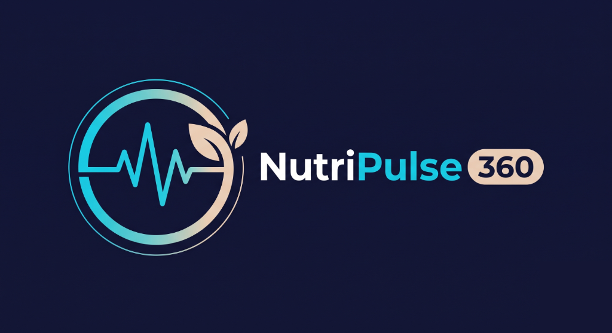
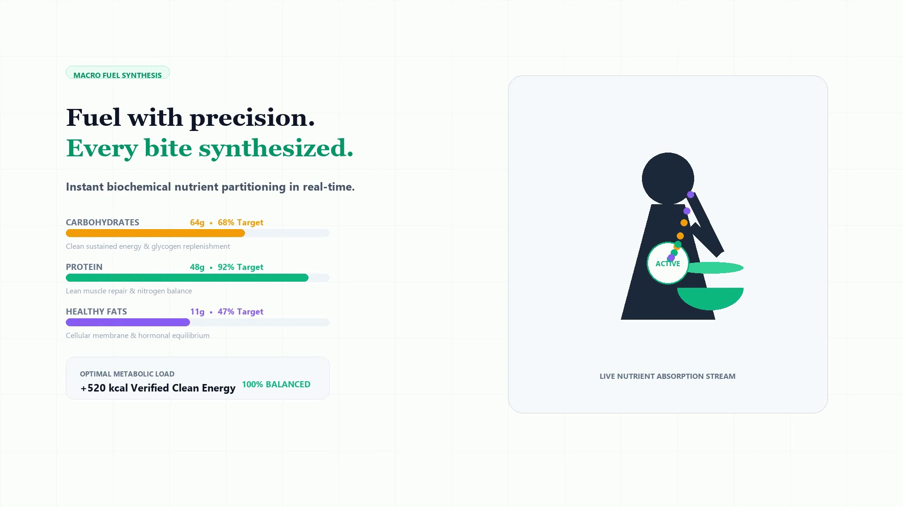
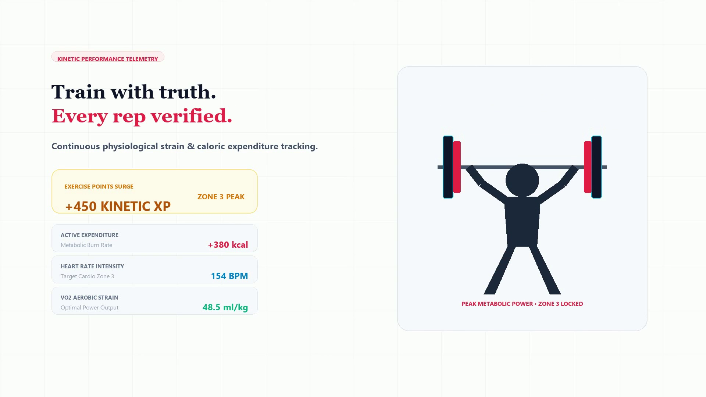
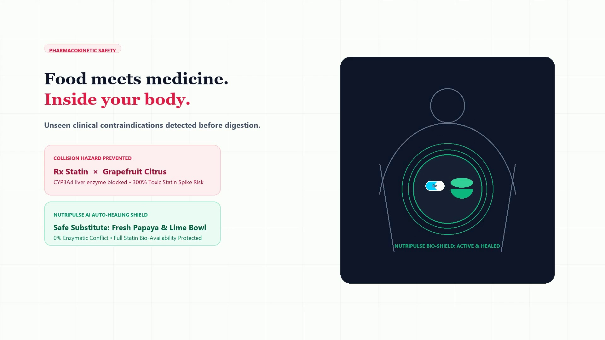
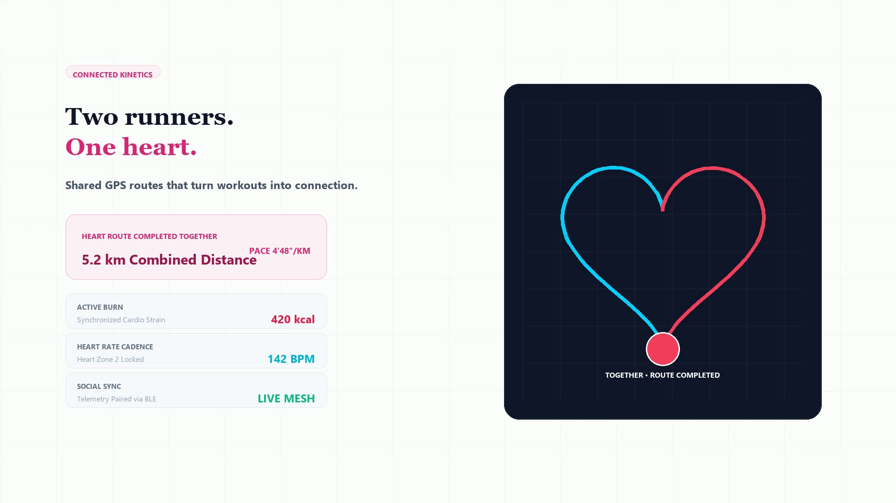

# 🥗 Snapbite (NutriPulse 360) — System Documentation & Technical Blueprint

<p align="center">
  
</p>

[](https://opensource.org/licenses/MIT)
[](https://www.typescriptlang.org/)
[](https://reactnative.dev/)
[](https://expo.dev/)
[](https://nextjs.org/)
[](https://supabase.com/)
[](https://ai.google.dev/)
[](https://www.meity.gov.in/)

> **Next-Generation AI-Driven Clinical Nutrition, Ephemeral Vision Analysis, and Cross-Platform Telemetry Ecosystem.**

---

## 📌 Table of Contents
- [Executive Overview & Value Proposition](#-executive-overview--value-proposition)
- [Architecture & Tech Stack](#-architecture--tech-stack)
- [Key Features Built](#-key-features-built)
- [Visual Showcase & User Flows](#-visual-showcase--user-flows)
- [Repository & Documentation Roadmap](#-repository--documentation-roadmap)
- [Local Development & Quickstart](#-local-development--quickstart)
- [Engineering Guardrails Summary](#-engineering-guardrails-summary)

---

## 🌟 Executive Overview & Value Proposition

### The Problem
1. **Friction-Heavy Calorie Tracking**: Traditional health apps require users to manually search, weigh, and log ingredients across convoluted databases, leading to a 78% user abandonment rate within the first 14 days.
2. **Clinical Blindness**: Mainstream diet apps treat food intake in a vacuum, ignoring the user's active prescription medications. For instance, prescribing high-potassium diets to patients on ACE inhibitors (inducing life-threatening hyperkalemia) or recommending grapefruit to statin users (causing severe rhabdomyolysis and hepatotoxicity).
3. **Data Privacy Overreach**: Most food-logging apps store raw personal meal photos permanently on cloud storage buckets, violating emerging global privacy standards such as the **Digital Personal Data Protection (DPDP) Act 2023** and **GDPR**.
4. **Disconnected Telemetry**: Wearable health metrics (heart rate, SpO2, blood pressure, GPS cadence) live in isolated silos away from nutritional tracking.

### The Snapbite Solution
**Snapbite (NutriPulse 360)** is an enterprise-grade mobile and cloud health platform engineered to bridge the gap between multimodal computer vision, institutional pharmacology, and IoT biometrics:
- **Ephemeral AI Vision Engine**: Analyzes whole meal plates, portions, and barcodes in under 1.5 seconds directly in volatile RAM, discarding raw images immediately after inference (Zero-Storage Architecture).
- **4-Layer Clinical Drug-Nutrient Safety Engine**: Cross-references every meal against user medications using deterministic pharmacological rule sets, NIH RxNav fuzzy matching, and live OpenFDA registries.
- **Cross-Platform Sensor Suite**: Captures real-time GPS workout routes, cadence, and medical Bluetooth Low Energy (BLE) peripheral telemetry (smart scales, BP monitors, SpO2).
- **Proactive AI Nutritionist**: Synthesizes biometric vitals, medication schedules, cultural cuisine preferences, and caloric goals into adaptive weekly meal strategies.

---

## 🛠️ Architecture & Tech Stack

| Layer | Technology | Version | Architectural Justification |
| :--- | :--- | :--- | :--- |
| **Mobile Frontend** | **React Native + Expo Router** | `0.86 / v57.0` | Enables a single TypeScript codebase deployed natively across iOS, Android, and Web, with instant deep-linking and hardware sensor modules. |
| **Web & API Backend** | **Next.js App Router** | `14.1.4` | Offers lightning-fast Server Actions, Edge API routes, unified SSR, and secure backend middleware without needing a separate standalone server. |
| **Relational Database** | **PostgreSQL (Supabase)** | `PG 15` | Provides enterprise relational integrity, JSONB support for meal planning schemas, and Row-Level Security (RLS) for patient-grade data isolation. |
| **ORM & Data Modeling** | **Prisma ORM** | `5.12.0` | Provides compile-time type safety, automated migrations, and high-performance querying across users, food logs, and telemetry models. |
| **Multimodal Vision & AI** | **Google Gemini 1.5 Flash** | `v0.24` | Chosen for its sub-second token latency, multi-modal image token parsing, and high accuracy in recognizing complex ethnic culinary dishes. |
| **Device Hardware** | **Expo Location & Core Bluetooth** | `v57.0` | Real-time GPS coordinate streaming, Haversine ground-distance calculation, and BLE GATT service discovery for medical health peripherals. |
| **Monetization & Entitlements**| **RevenueCat SDK** | `v8.0` | Abstracts Apple StoreKit 2 and Google Play Billing with real-time server-side webhook validation and anti-tampering guards. |
| **UI & Styling** | **TailwindCSS / NativeWind** | `v3.4` | Atomic utility-first design system ensuring exact visual parity between mobile devices and responsive web dashboards. |

---

## ⚡ Key Features Built

- **📸 Zero-Storage Multimodal Food Scanner**: Photograph any food plate or packaging; Gemini Vision calculates caloric density, macronutrient breakdowns (Protein, Carbs, Fats), and glycemic load within volatile memory. Zero photo bytes are stored in the database.
- **💊 Institutional Drug-Drug & Drug-Nutrient Safety Guardrails**: Real-time evaluation of food ingredients against active medications (e.g., detecting Tyramine in aged cheeses for MAOI users, or Vitamin K surges for Warfarin patients).
- **🗺️ Live GPS Route Telemetry & Athletic Silhouette Cards**: Tracks live running and walking routes with jitter rejection filters, generates polyline route maps, and renders exportable social trophy cards.
- **🩺 BLE Medical Peripheral Discovery**: Connects directly via Bluetooth Low Energy to certified blood pressure monitors, continuous glucose monitors (CGM), smart scales, and pulse oximeters.
- **🍲 Adaptive Cultural Meal Planner**: Custom-tailored meal scheduling respecting cultural/regional cuisines (Indian, Mediterranean, Western, East Asian) while aligning with diabetic or hypertension restrictions.
- **💧 Smart Hydration & Habit Streaks**: Dynamic water consumption targets calculated from ambient temperature, active calories burned, and real-time habit completion micro-streaks.
- **🔒 DPDP Act 2023 & GDPR Privacy Compliance**: One-click data export, automated 14-day log pruning for free-tier users, and absolute "Right to be Forgotten" account purges.

---

## 📱 Visual Showcase & User Flows

```
+---------------------------------------------------------------------------------------+
|                                SNAPBITE APPLICATION FLOW                              |
+---------------------------------------------------------------------------------------+
|                                                                                       |
|   +--------------------+      +--------------------+      +-----------------------+   |
|   |  1. Login / Auth   | ---> |  2. Vitals & Home  | ---> |   3. Ephemeral Scan   |   |
|   |  - NextAuth / JWT  |      |  - Daily Targets   |      |  - Gemini 1.5 Flash   |   |
|   |  - Biometric Lock  |      |  - BLE Vitals Sync |      |  - Zero Image Storage |   |
|   +--------------------+      +--------------------+      +-----------------------+   |
|                                                                       |               |
|                                                                       v               |
|   +--------------------+      +--------------------+      +-----------------------+   |
|   |  6. Pro Paywall    | <--- |  5. GPS Workouts   | <--- |   4. Safety Analysis  |   |
|   |  - RevenueCat Pro  |      |  - Haversine Pace  |      |  - Drug-Nutrient DDI  |   |
|   |  - Quota Guards    |      |  - Polyline Render |      |  - Clinical Advisory  |   |
|   +--------------------+      +--------------------+      +-----------------------+   |
|                                                                                       |
+---------------------------------------------------------------------------------------+
```

### 📸 Interface & Live Feature Screenshots (Widescreen Advert Showcase)

| Macro Fuel Synthesis & Real-Time Partitioning | Kinetic Performance Telemetry & Strain |
| :---: | :---: |
|  |  |
| **Instant biochemical macro partitioning (Carbs, Protein, Healthy Fats) in real-time.** | **Active expenditure (+450 Kinetic XP), Zone 3 peak cardio & VO2 strain.** |

| Pharmacokinetic Collision Shield & Auto-Heal | Connected Kinetics Heart GPS Route Map |
| :---: | :---: |
|  |  |
| **Rx Statin × Grapefruit CYP3A4 collision detection with AI Papaya auto-heal.** | **Parametric dual-runner GPS route map completing a 5.2 km shared heart.** |

### Media Assets & Live Walkthrough Demos
- 🎬 **Widescreen Showcase Advert**: `assets/NutriPulse_360_Widescreen_Advert.mp4`
- 🖥️ **Interactive Ad Showcase**: `bon-appetit-mobile/assets/NutriPulse_360_Ad_Showcase.html`

---

## 📂 Repository & Documentation Roadmap

This documentation repository is partitioned into engineering system design artifacts:

```
Snapbite-Documents/
├── README.md                      # Primary technical landing page & project brief
├── .github/
│   └── workflows/
│       └── ci-cd-pipeline.yml     # Automated CI/CD: Linting, Typecheck, Jest, Security Audit
├── docs/
│   ├── architecture.md            # High-level system design, Mermaid sequence diagrams, data flows
│   ├── api-spec.md                # Full REST API contracts, request/response schemas, error handling
│   ├── database-schema.md         # Visual Mermaid ERD, relational tables, indexes, cascading rules
│   └── guardrails.md              # Exhaustive safety guardrails for every implemented feature
└── examples/
    ├── core-feature-snippet.ts    # Production 4-layer Drug Interaction Engine snippet
    └── README.md                  # Code quality analysis: Design patterns, error handling, standards
```

### Quick Documentation Links:
- 📐 [System Architecture & Data Flows](docs/architecture.md)
- 📡 [API Specification & Contracts](docs/api-spec.md)
- 🗄️ [Database Schema & ERD](docs/database-schema.md)
- 🛡️ [System Guardrails & Clinical Safety Matrix](docs/guardrails.md)
- 💻 [Isolated Code Trailer & Architecture Patterns](examples/core-feature-snippet.ts)

---

## 🚀 Local Development & Quickstart

### Prerequisites
- Node.js `v18.x` or `v20.x`
- npm `v9+` or yarn `v1.22+`
- Expo Go App on physical iOS/Android device (or Xcode Simulator / Android Studio Emulator)

### 1. Clone & Install Dependencies
```bash
# Clone the mobile codebase
cd "bon-appetit-mobile"
npm install

# In the root web/backend project
cd ..
npm install
```

### 2. Configure Environment Variables
Create `.env` in `bon-appetit-mobile/`:
```env
EXPO_PUBLIC_SUPABASE_URL=https://your-project.supabase.co
EXPO_PUBLIC_SUPABASE_ANON_KEY=your-anon-key
EXPO_PUBLIC_GEMINI_API_KEY=your-gemini-api-key
EXPO_PUBLIC_REVENUECAT_APPLE_KEY=appl_your_key
EXPO_PUBLIC_REVENUECAT_GOOGLE_KEY=goog_your_key
```

### 3. Launch Development Server
```bash
# Start Expo Metro Bundler
npm run start

# Launch on Android
npm run android

# Launch on iOS
npm run ios

# Launch Web Dashboard
npm run web
```

---

## 🛡️ Engineering Guardrails Summary

| Functional Area | Core Guardrail Implemented | Failure Mitigation |
| :--- | :--- | :--- |
| **Food & Vision AI** | Zero-Storage Ephemeral RAM processing | Images never hit disk or S3 buckets; memory freed post-inference. |
| **Pharmacology** | Deterministic 4-tier drug-food matrix | Instant local lookup (<5ms) prevents hallucinatory LLM approvals. |
| **GPS Athletics** | Haversine velocity filter & jitter threshold | Rejects stationary GPS drift (<25m in 8s ignored). |
| **API Quotas** | Daily consumption rate-limiting per user tier | Free users capped at 5 scans/day; automatic paywall tripwire. |
| **Compliance** | DPDP Act 2023 & GDPR automated cron purge | Free user biometric logs auto-purged after 14 days without consent. |

*(For full in-depth specifications of all 8 system guardrails, view [docs/guardrails.md](docs/guardrails.md)).*

---

## 👥 Engineering & Hackathon Credits
- **Project Lead & Architecture**: Shiva Kumar Kondala
- **Clinical Knowledge Base**: NIH RxNav & U.S. National Library of Medicine
- **Repository**: [Snapbite Documents](https://github.com/Shivakumar74/Snapbite-Documents)
