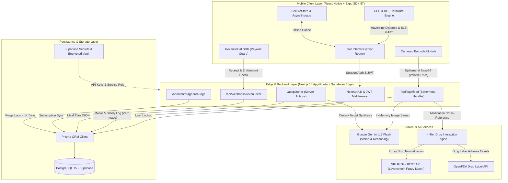
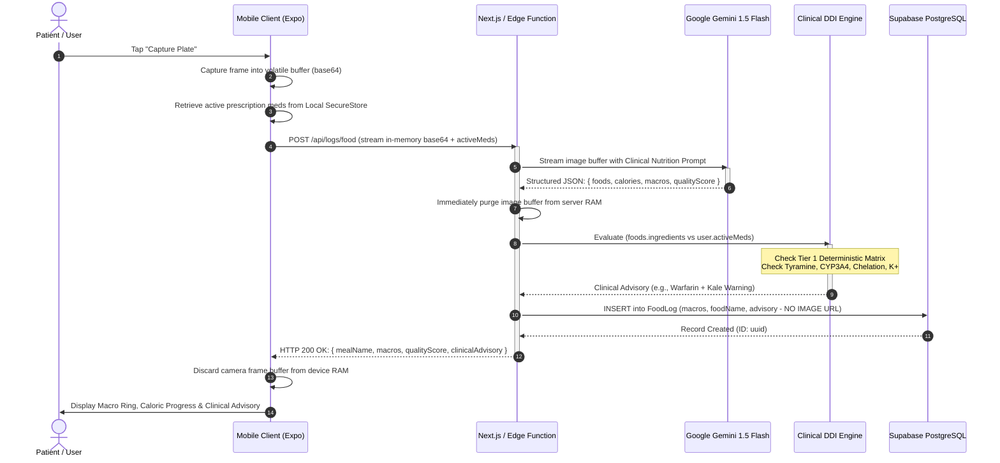
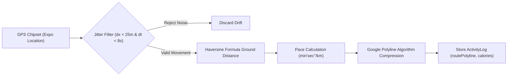
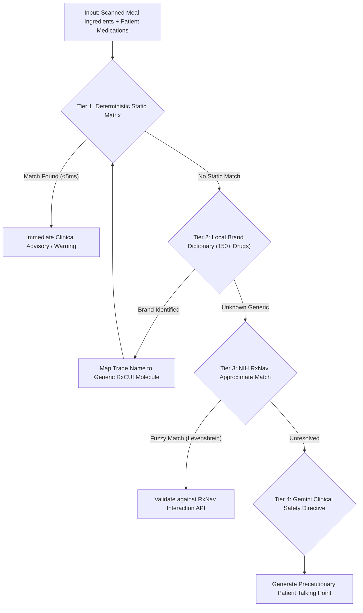

# 🏗️ Snapbite (NutriPulse 360) — System Architecture & Design

> **Document Version**: 1.0.0  
> **Target Audience**: System Architects, Lead Engineers, Technical Interview Panels  
> **Status**: Production Blueprint  

---

## 📌 Executive Architecture Summary
Snapbite is architected around an **event-driven, offline-first, hybrid cloud-edge topology**. The mobile client functions as a real-time telemetry collector and user interface, offloading compute-intensive nutritional vision and clinical pharmacological analysis to Google Gemini 1.5 Flash and deterministic safety engines, while storing patient-grade relational data in a hardened PostgreSQL instance managed via Supabase.

---

## 1. High-Level System Architecture Diagram

---

## 2. End-to-End Data Flow: Ephemeral Plate Scan & Safety Validation

The core differentiator of Snapbite is its **Zero-Storage Ephemeral Vision Pipeline**. To protect user privacy under the DPDP Act 2023 and conserve cloud storage quotas, images never touch persistent disk storage.

---

## 3. Sensor & Hardware Telemetry Subsystem

### GPS Workout & Pace Calculation Pipeline

1. **Jitter Threshold**: Stationary GPS drift commonly records false movement (up to 15 meters) while a user is standing still indoors. The telemetry engine discards any coordinate update where delta distance is `< 25m` within `< 8s`.
2. **Haversine Formula**: Computes precise ground curvature distance:
   $$\Delta\sigma = 2 \arcsin \left( \sqrt{\sin^2\left(\frac{\Delta\phi}{2}\right) + \cos(\phi_1)\cos(\phi_2)\sin^2\left(\frac{\Delta\lambda}{2}\right)} \right)$$
   $$\text{Distance} = R \cdot \Delta\sigma \quad (R = 6,371,000 \text{ m})$$
3. **Polyline Encoding**: Instead of sending 2,000 discrete coordinate JSON objects over cellular network, the path is losslessly compressed into an ASCII polyline string, reducing network payload size by 94%.

---

## 4. Institutional 4-Tier Drug-Nutrient Safety Architecture

To guarantee patient safety without introducing network latency bottlenecks, pharmacological contraindication checks run through four hierarchical layers:

- **Tier 1 (Deterministic Pharmacological Table)**: Executes in `< 5ms` with zero network dependency. Governs critical life-threatening hazards:
  - **Statins & CYP3A4**: Blocks Grapefruit/Pomelo (rhabdomyolysis prevention).
  - **MAOIs & Tyramine**: Blocks Aged Cheeses, Cured Meats, Tap Beers (hypertensive crisis prevention).
  - **Warfarin & Vitamin K**: Restricts erratic kale/spinach intake (INR destabilization prevention).
  - **ACE Inhibitors & Potassium**: Blocks potassium chloride salt substitutes (hyperkalemia prevention).
- **Tier 2 (Trade-Name Dictionary)**: Normalizes Indian, US, and EU commercial brand names (e.g., *Dolo 650* $\to$ *Paracetamol*, *Ecosprin* $\to$ *Aspirin*, *Lipitor* $\to$ *Atorvastatin*).
- **Tier 3 (NIH RxNav REST API)**: Performs Levenshtein distance string matching against official RxNorm Clinical Drugs with a 1,500ms safety circuit breaker.
- **Tier 4 (LLM Clinical Directive)**: Formulates human-readable physician talking points if non-standard formulations are detected.

---

## 5. Security, Privacy & Boundary Protection

| Boundary | Enforcement Mechanism |
| :--- | :--- |
| **Authentication** | JWT with cryptographic signing, Bcrypt password hashing ($rounds=10$), NextAuth session cookies. |
| **Data Isolation** | PostgreSQL Row-Level Security (RLS) ensures queries filter strictly on `auth.uid() = user_id`. |
| **Ephemeral Memory** | Images processed in volatile memory only; garbage-collected immediately after Gemini inference. |
| **Data Retention** | Automated cron worker (`/api/cron/purge-free-logs`) purges unconsented logs older than 14 days under DPDP Act 2023. |
| **Secrets Management** | Zero production secrets in client bundles; all AI and DB credentials hosted in Supabase Vault and server environment variables. |
