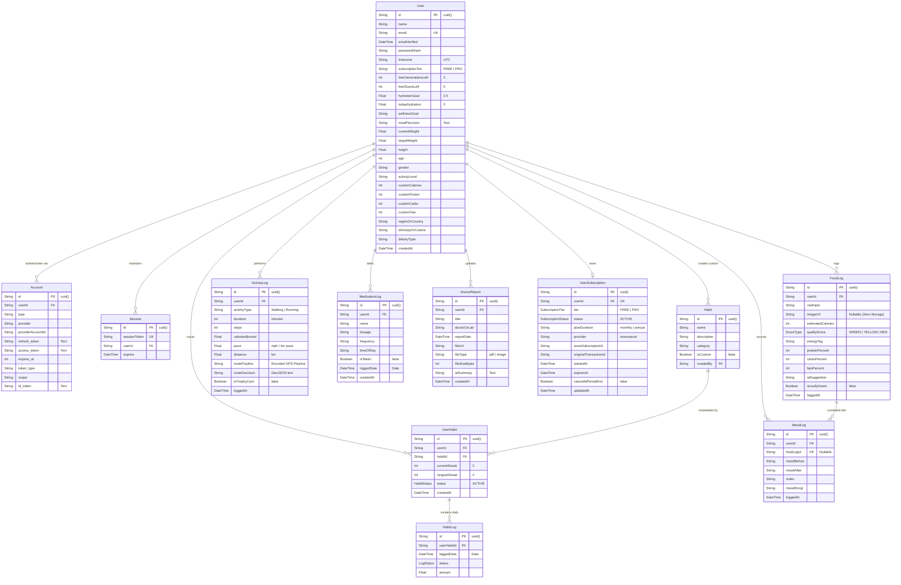

# 🗄️ Snapbite (NutriPulse 360) — Database Schema & Data Dictionary

> **Database Engine**: PostgreSQL 15 (Supabase Managed Cloud)  
> **ORM & Migration Tool**: Prisma ORM v5.12.0  
> **Character Encoding**: UTF-8  
> **Security Model**: Row-Level Security (RLS) + Foreign Key Cascades  

---

## 📌 1. Entity-Relationship Diagram (ERD)

The following Mermaid ERD maps the relational domain entities across user authentication, health telemetry, clinical medication logs, habits, and subscription entitlements.



---

## 📌 2. Detailed Data Dictionary & Field Specifications

### Table: `User`
The root identity and clinical baseline record for all subscribers.
| Column | Type | Nullable | Default | Description |
| :--- | :--- | :--- | :--- | :--- |
| `id` | `VARCHAR(30)` | No | `cuid()` | Unique primary key. |
| `name` | `VARCHAR(255)` | Yes | `NULL` | Full patient name. |
| `email` | `VARCHAR(255)` | Yes | `NULL` | Unique email for authentication. Indexed. |
| `passwordHash` | `VARCHAR(255)` | Yes | `NULL` | Bcrypt password digest ($rounds=10$). |
| `subscriptionTier` | `VARCHAR(20)` | Yes | `'FREE'` | Current active tier (`FREE` or `PRO`). |
| `freeScansLeft` | `INTEGER` | Yes | `5` | Daily remaining ephemeral plate scans. |
| `freeGenerationsLeft`| `INTEGER` | Yes | `3` | Daily remaining AI meal plan requests. |
| `hydrationGoal` | `FLOAT` | No | `2.5` | Dynamic water target in liters/day. |
| `currentWeight` | `FLOAT` | Yes | `70.0` | Weight in kilograms. |
| `targetWeight` | `FLOAT` | Yes | `70.0` | Goal weight in kilograms. |
| `height` | `FLOAT` | Yes | `170.0` | Height in centimeters. |
| `age` | `INTEGER` | Yes | `30` | Age in years. |
| `gender` | `VARCHAR(20)` | Yes | `'Male'` | Biological sex for BMR calculation. |
| `activityLevel` | `VARCHAR(30)` | Yes | `'Sedentary'` | Sedentary, Light, Moderate, Heavy. |
| `mealPlanJson` | `TEXT` | Yes | `NULL` | Serialized 7-day nutritional planner output. |
| `regionOrCountry`| `VARCHAR(100)`| Yes | `'United States'` | Geographical region for local food staples. |
| `ethnicityOrCuisine`|`VARCHAR(100)`| Yes | `'Western'` | Preferred culinary tradition (e.g. South Indian). |

---

### Table: `FoodLog`
Records nutritional intake from text entries or ephemeral plate scans.
| Column | Type | Nullable | Default | Description |
| :--- | :--- | :--- | :--- | :--- |
| `id` | `UUID` | No | `uuid()` | Primary key. |
| `userId` | `VARCHAR(30)` | No | - | Foreign Key $\to$ `User.id` (`ON DELETE CASCADE`). |
| `rawInput` | `TEXT` | No | - | Meal description or camera detection title. |
| `imageUrl` | `TEXT` | Yes | `NULL` | **Zero-Storage architecture**: Kept null for camera scans. |
| `estimatedCalories`| `INTEGER`| Yes | `NULL` | Total computed energy content (kcal). |
| `qualityScore` | `ScoreType` | No | - | Enum: `GREEN` (Nutritious), `YELLOW`, `RED` (Ultra-processed). |
| `energyTag` | `VARCHAR(50)` | Yes | `NULL` | "High Protein", "Low Carb", "Energy Dense". |
| `proteinPercent`| `INTEGER` | Yes | `NULL` | Ratio of total calories from protein. |
| `carbsPercent` | `INTEGER` | Yes | `NULL` | Ratio of total calories from carbohydrates. |
| `fatsPercent` | `INTEGER` | Yes | `NULL` | Ratio of total calories from fats. |
| `aiSuggestion` | `TEXT` | Yes | `NULL` | Proactive clinical tips (e.g. add fiber). |
| `isLeafyGreen` | `BOOLEAN` | No | `false` | Trigger flag for Warfarin Vitamin K cross-checks. |
| `loggedAt` | `TIMESTAMP` | No | `now()` | UTC timestamp of nutritional intake. |

---

### Table: `ActivityLog`
Stores athletic route coordinates, paces, and calorie expenditures.
| Column | Type | Nullable | Default | Description |
| :--- | :--- | :--- | :--- | :--- |
| `id` | `UUID` | No | `uuid()` | Primary key. |
| `userId` | `VARCHAR(30)` | No | - | Foreign Key $\to$ `User.id` (`ON DELETE CASCADE`). |
| `activityType` | `VARCHAR(50)` | No | - | "Walking", "Running", "Jogging", "Cycling". |
| `duration` | `INTEGER` | No | - | Active workout time in minutes. |
| `steps` | `INTEGER` | Yes | `NULL` | Hardware pedometer step count. |
| `caloriesBurned`| `FLOAT` | No | - | Active kilocalories burned via metabolic equivalent. |
| `pace` | `FLOAT` | Yes | `NULL` | Average athletic speed or pace per km. |
| `distance` | `FLOAT` | Yes | `NULL` | Distance traversed in kilometers. |
| `routePolyline` | `TEXT` | Yes | `NULL` | Lossless Google Polyline encoded GPS coordinate string. |
| `routeGeoJson` | `TEXT` | Yes | `NULL` | Raw GeoJSON LineString array for web maps. |
| `isTrophyCard` | `BOOLEAN` | No | `false` | Social badge eligibility flag. |
| `loggedAt` | `TIMESTAMP` | No | `now()` | Session completion timestamp. |

---

### Table: `MedicationLog`
Maintains prescription schedules to power the Clinical DDI Engine.
| Column | Type | Nullable | Default | Description |
| :--- | :--- | :--- | :--- | :--- |
| `id` | `UUID` | No | `uuid()` | Primary key. |
| `userId` | `VARCHAR(30)` | No | - | Foreign Key $\to$ `User.id` (`ON DELETE CASCADE`). |
| `name` | `VARCHAR(255)`| No | - | Trade or Generic drug name (e.g., "Atorvastatin"). |
| `dosage` | `VARCHAR(100)`| No | - | Prescribed dosage (e.g., "20mg"). |
| `frequency` | `VARCHAR(100)`| Yes| `NULL` | "Once daily", "Twice daily with meals". |
| `timeOfDay` | `VARCHAR(50)` | Yes| `NULL` | "Morning", "Night", "08:00 AM". |
| `isTaken` | `BOOLEAN` | No | `false` | Patient adherence toggle. |
| `loggedDate` | `DATE` | No | - | Target prescription calendar date. |

---

### Table: `UserSubscription`
Authoritative billing and entitlement state synced with RevenueCat.
| Column | Type | Nullable | Default | Description |
| :--- | :--- | :--- | :--- | :--- |
| `id` | `VARCHAR(30)` | No | `cuid()` | Primary key. |
| `userId` | `VARCHAR(30)` | No | - | Foreign Key $\to$ `User.id` (`UNIQUE`). |
| `tier` | `SubscriptionTier`| No| `'FREE'`| Enum: `FREE` or `PRO`. |
| `status` | `SubscriptionStatus`| No| `'INACTIVE'`| Enum: `INACTIVE`, `TRIALING`, `ACTIVE`, `PAST_DUE`, `CANCELED`. |
| `provider` | `VARCHAR(50)` | No | `'revenuecat'` | StoreKit 2, Play Billing, or RevenueCat. |
| `storeSubscriptionId`|`VARCHAR(100)`|Yes| `NULL`| App Store Product ID (`ba_pro_1m_149`). |
| `expiresAt` | `TIMESTAMP` | Yes| `NULL` | Period end timestamp. |
| `cancelAtPeriodEnd`| `BOOLEAN`| No | `false` | True if auto-renew was disabled by user. |

---

## 📌 3. Enumerations & Composite Types

```sql
CREATE TYPE "SubscriptionTier" AS ENUM ('FREE', 'PRO');
CREATE TYPE "SubscriptionStatus" AS ENUM ('INACTIVE', 'TRIALING', 'ACTIVE', 'PAST_DUE', 'CANCELED', 'EXPIRED');
CREATE TYPE "HabitStatus" AS ENUM ('ACTIVE', 'PAUSED', 'ABANDONED');
CREATE TYPE "LogStatus" AS ENUM ('COMPLETED', 'MISSED', 'RECOVERED');
CREATE TYPE "ScoreType" AS ENUM ('GREEN', 'YELLOW', 'RED');
```

---

## 📌 4. Database Indexing Strategy
To optimize high-traffic queries and latency guarantees:
1. `User(email)`: Unique B-Tree index for instantaneous credential lookups during sign-in.
2. `UserHabit(userId, habitId)`: Compound unique index preventing duplicate habit tracking entries.
3. `HabitLog(userHabitId, loggedDate)`: Unique constraint enforcing idempotency for daily habit toggles.
4. `MedicationLog(userId, loggedDate)`: Compound index optimizing instantaneous prescription retrieval on meal scans.
5. `DoctorReport(userId, createdAt)`: Compound index for chronological medical record pagination.
6. `UserSubscription(userId, status)`: Indexed for sub-millisecond Pro entitlement checks in API routes.
7. `UserSubscription(expiresAt)`: Indexed for automated webhook subscription expiration sweeps.
